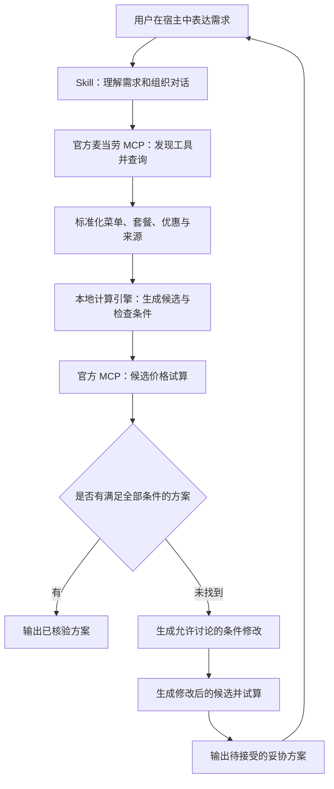

# 麦麦不将就：具体实现路径

版本：v1.0  
编写日期：2026-10-12（北京时间）  
项目建议标识：`mcd-minimal-compromise`  
文档性质：实施设计，尚未进行真实 MCP 接入或编码验证。

> 预算、口味、营养难以兼得时，找到你最愿意接受的那一点改变。

## 1. 产品目标与首版决策

面向独自用餐的学生、上班族和经常使用优惠券的用户，解决一个具体问题：当用户提出的要求在当前门店无法同时满足时，解释哪里发生冲突，并提供经过价格验证的最小调整方案。

产品核心是“要求可保留、冲突可解释、改变可比较”。完成一次协商后，用户能清楚知道自己吃什么、花多少钱、哪些要求得到保留、哪些需要自己接受调整。

首版采用“宿主中的 Skill + 本地计算引擎 + 官方麦当劳 MCP”架构。先实现到店自取的单人单餐规划，输出点餐清单；营养约束作为第二阶段增强；创建订单作为后续可选功能。先让推荐和协商可靠，不依赖完整网站或支付流程才能演示价值。

### 1.1 首版范围

| 功能 | 首版决定 | 完成标准 |
|---|---|---|
| 门店与就餐方式 | 单门店、到店自取、当前用餐 | 用户选择门店，所有候选使用同一上下文 |
| 需求理解 | 预算、主食、饮料、排除餐品、偏好排序 | 形成可校验的结构化需求 |
| 真实数据 | 当前菜单、套餐详情、当前门店可用优惠 | 餐品和替换选项有来源 |
| 方案规划 | 单点与已知合法套餐组合 | 最多输出三个有区别的方案 |
| 价格验证 | 调用官方价格试算 | 展示总价、优惠和查询时间 |
| 冲突处理 | 对可讨论条件生成修改建议 | 明确改了什么、保留了什么 |
| 多轮协商 | 用户修改一个条件后重新计算 | 其他条件保持原样 |
| 营养目标 | 第二阶段接入 | 仅使用可可靠匹配的数据 |
| 下单 | 首版输出清单；后续增加订单创建 | 订单创建前重新核验并确认 |

首版不包含多人分餐、跨门店全局比价、自动领券、积分兑换、长期饮食计划和实时到餐时间预测。以上功能会扩大状态空间，且不能直接加强最小妥协体验。

### 1.2 用户成功指标

- 用户用一句话表达需求后，可以得到方案或明确的补充问题。
- 遇到冲突时，用户能直接比较两到三个可执行调整，不必重新描述全部需求。
- 展示为“已核验”的方案均来自有效价格试算，且不违反当前生效的硬条件。
- 数据不全或查询失败时，输出“暂时无法验证”，不误报为“要求无法满足”。

## 2. 关键交互设计

### 2.1 开场示例

用户：

> 预算 25 元，要一个牛肉汉堡和一杯饮料，不要薯条，优先用我的券。

系统先展示简短需求摘要：

> 已记下：25 元以内；一个牛肉汉堡；一杯饮料；不要薯条；有合适的券优先用。找不到符合全部条件的组合时，我会把需要改变的条件单独列出来。

如果“25 元”与用户后续描述存在歧义，或者缺少门店，则提出有针对性的补充问题。无需对每个已清楚表达的条件逐项确认。

### 2.2 找到可行方案

显示实际餐品、规格、套餐展开项、有效优惠、试算总价，以及条件满足情况。若只有一个合适方案，直接展示一个，不为凑数加入较差方案。

### 2.3 未找到可行方案

以下为虚构测试场景，用于说明交互，不代表实际餐品价格或优惠：

| 方案 | 保留 | 需要接受的改变 | 输出状态 |
|---|---|---|---|
| A | 牛肉汉堡、饮料、无薯条 | 预算从 25 元提高到 27 元 | 待接受预算修改 |
| B | 25 元内、饮料、无薯条 | 将牛肉主食换为用户允许讨论的其他主食 | 待接受主食修改 |

超预算方案不能标为满足原需求。用户说“选 A”后，新预算才进入生效条件，随后重新试算。若用户明确说“预算绝对不能变”，不再推荐超预算方案。

### 2.4 追问与连续协商

用户：

> 预算不能变，汉堡可以换，但饮料别取消。

系统更新预算的可讨论属性、开放主食替换，并保留饮料和无薯条要求。每轮保存需求版本，方案绑定版本；用户不能误选上一版本下已过期的方案。

## 3. 需求模型：先把“底线”定义清楚

约束分成三个独立维度，避免把“当前必须满足”和“永远不可讨论”混为一谈。

| 维度 | 含义 | 示例 |
|---|---|---|
| 生效强度 | 当前方案必须满足，或仅作为排序偏好 | “25 元以内”是当前硬条件；“优先用券”是偏好 |
| 可讨论性 | 失败时是否可以提出修改建议 | “预算绝不能变”不可讨论；普通预算可提出修改但不能直接突破 |
| 优先级 | 多个允许修改的条件中先讨论哪个 | 先改饮料规格，最后讨论指定主食 |

用户明确强调“绝不”“必须保留”等条件时，应保守处理；除非用户之后明确修改，否则不得松动。对没有明确可讨论性的指定餐品，可提出针对性问题，而不是自行替换。

### 3.1 内部数据示例

以下 JSON 是项目内部结构，不是官方 MCP 参数：

```json
{
  "requestVersion": 1,
  "context": {
    "storeId": "selected-store",
    "diningMode": "pickup",
    "people": 1
  },
  "constraints": [
    {
      "id": "budget",
      "kind": "total_price_max",
      "value": 2500,
      "unit": "fen",
      "strength": "hard",
      "negotiability": "ask",
      "sourceText": "预算25元"
    },
    {
      "id": "exclude_fries",
      "kind": "exclude_category",
      "value": "fries",
      "strength": "hard",
      "negotiability": "locked",
      "sourceText": "不要薯条"
    }
  ]
}
```

金额统一以整数“分”计算；餐品数量与规格必须有明确字段；未提供的属性使用 `unknown`，不能当成 `false` 或零。品类和食材标签是内部标准化结果，应记录映射依据与置信度。

“不要薯条”需要检查套餐展开后的所有组成；“不要某酱料”仅在官方返回支持对应特制且参数明确时，才能生成去除选项。首版不根据商品名推断过敏原安全，也不把一般口味排除描述成医疗保障。

## 4. 技术架构与交付形态



### 4.1 模块职责

| 模块 | 负责内容 | 边界 |
|---|---|---|
| Skill | 意图提取、必要追问、工具调用顺序、解释、多轮更新 | 不自行编造价格、商品编码或券规则 |
| MCP 适配层 | 官方参数映射、结果解析、错误分类、数据脱敏 | 不把内部字段名当作官方字段名 |
| 标准化层 | 套餐展开、变体、选项、来源标记 | 未知选项不视作合法替换 |
| 计算引擎 | 枚举候选、条件检查、妥协比较、去重 | 不依赖模型自由心算 |
| 试算管理 | 请求去重、调用预算、报价状态、失败恢复 | 未成功试算的候选不能进入已核验列表 |
| 会话状态 | 需求版本、选定门店、候选与证据 | 首版只做当前会话记忆 |

### 4.2 建议技术路线

首版计算引擎使用 Python、标准库和 pytest，采用 JSON 输入输出，先保持依赖少。开发开始时固定实际验证过的运行环境和依赖版本。组合规模较小，先实现可解释枚举，暂不引入大型优化框架。

宿主直接连接官方 MCP；Skill 将脱敏后的标准化数据交给本地脚本，再根据脚本返回的候选调用官方试算。计算脚本不接收 Token。

在第 0 阶段验证宿主是否支持 Skill 调用本地脚本。如果不支持，则提供一个本地编排服务封装计算与官方连接，Skill 调用该服务；这是替代实现路径，不与首版两套同时开发。不要退回让模型自由计算所有组合。

建议优先选择一个已实测可用的宿主作为首发环境，并在 README 写清楚适用范围。若计划参加 WorkBuddy 专项奖励，应真实在 WorkBuddy 中开发和验证，并整理实际开发上下文。

## 5. 官方能力核对与接入顺序

官方工具目录列出了门店、菜单、套餐详情、门店优惠、价格试算和营养查询等能力；接入地址为 `https://mcp.mcd.cn`，使用 Streamable HTTP 与 Bearer Token。文档提供的是能力说明，具体参数和返回字段应以真实工具发现结果为准。[官方 MCP 使用指南](https://github.com/M-China/mcd-mcp-server)

### 5.1 计划使用的工具

| 工具 | 项目用途 | 阶段 |
|---|---|---|
| `query-nearby-stores` | 建立门店上下文，由用户选店 | P0 |
| `query-meals` | 获取门店可选菜单 | P0 |
| `query-meal-detail` | 获取套餐组成和合法替换项 | P0 |
| `query-store-coupons` | 获取当前门店可用优惠 | P0 |
| `calculate-price` | 核验候选总价 | P0 |
| `list-nutrition-foods` | 为可靠匹配的餐品附加营养数据 | P1 |
| `create-order` | 用户选定并确认后创建订单 | P2，可选 |

该表为依据官方工具清单制定的集成计划，尚未确认本账号可用权限、参数细节及返回覆盖率。

### 5.2 第一次接入必须验证的事项

1. 初始化 MCP 连接，获取 `tools/list`，保存不含凭证的工具 schema 快照。
2. 确认地址或位置输入格式、门店标识，以及就餐方式和时间的真实参数。
3. 查询一个真实门店菜单，确认分页、规格、售价字段和可售状态。
4. 查询一个套餐详情，确认选项组、必选数量、合法替换与餐品编码。
5. 查询门店优惠，确认券实例、适用餐品、使用方式及不可叠加条件的可见程度。
6. 对一个简单候选执行价格试算，确认含券请求格式、币种单位和总价组成。
7. 用两个有效候选验证同一优惠的独立试算是否可行，确认试算有无状态变化。
8. 检查真实返回与当前设计的差异，完成 `MCP_INTEGRATION.md` 后再扩展算法。

优惠是否可叠加、替换是否支持、试算是否有额外费用，均不得凭名称猜测。接口没有暴露的条件应标记未知，交给官方试算确认。

### 5.3 正常调用流程

选门店 → 查询菜单和门店优惠 → 查询相关套餐详情 → 标准化 → 生成候选 → 分批试算 → 检查条件 → 输出方案或进入协商。

菜单与优惠查询在门店上下文确定后可以并发；套餐详情依赖菜单编码；价格试算依赖合法候选。这些依赖不能颠倒。

首版不调用自动领券或兑换工具。“优先用我的券”仅指当前账号、当前门店可用的优惠；使用优惠后的总价与不用券总价分别核验，避免假设用券一定更便宜。

## 6. 最小妥协算法

### 6.1 明确搜索边界

首版搜索空间建议限定为：一个选定门店、当前自取场景、一份主食、零或一份饮料、零或一份允许的小食，以及满足此结构的套餐和合法替换。

排除多份重复商品、跨订单拆单、跨账号用券、未知替换选项和超出结构的大型分享餐。这个边界必须在结果中可查，避免把有限搜索说成覆盖所有可能点法。

### 6.2 生成候选

1. 展开套餐组成，建立餐品变体和合法选项。
2. 按锁定条件过滤，例如排除含薯条的完整组合。
3. 生成单点组合、套餐组合，以及根据接口信息可用的含券变体。
4. 以门店、方式、餐品编码、规格、数量、特制、套餐选项和券实例构建规范化键，去重。
5. 优先覆盖不同结构和潜在妥协方向，再按可信价格线索安排试算顺序。

没有可靠价格下界时，不能根据标价剪除“看起来超预算”的候选，优惠可能改变结果。单点被套餐“支配”的判断也必须考虑券适用性和具体组成，不能只比较标价。

### 6.3 报价预算与最优性

建议开发初始配置：首批试算 8 个候选，单轮最多 24 个候选，并限制并发为 2。以上是待实测的项目配置，不是官方性能承诺。

- 当合法候选全部成功试算：可说“在本次定义的搜索范围内，已找到最低价/最少修改方案”。
- 当只试算部分候选：说“在已核验的候选中推荐”。
- 达到调用预算但没有可行方案：说“本轮尚未找到”，提供继续扩大搜索的入口。
- 有候选报价失败：标记覆盖不完整，不把失败项当成不可行。

优先保证输出有证据，不为了宣称全局最优而发起大量试算。

### 6.4 条件检查

对每个已报价候选计算：

```text
hard_pass: 当前所有硬条件是否满足
locked_pass: 所有不可讨论条件是否满足
violations: 未满足的条件、目标值、实际值、证据
unknowns: 因数据缺失而无法判定的条件
soft_scores: 偏好满足情况
```

条件评价采用满足、违反、未知三态。包含未知硬条件的候选不进入“全部满足”列表。

### 6.5 提出最小妥协

当前需求没有可行结果时，针对允许讨论的条件构建修改请求，先探索只改变一个条件的方案，再探索改变两个条件的方案。每个修改请求仍需生成合法候选并试算。

排序采用可解释的顺序，避免用一个任意加权总分混合元、克和偏好：

```text
先拒绝违反锁定条件的候选
再比较需要修改的条件数量
再按用户明确的条件优先级比较
同一修改方向内比较改动幅度
最后比较试算总价和一般偏好
```

例如，同为只修改预算的方案，选择所需增额更小者；“加 2 元”与“换主食”之间不默认谁更好，应并列展示或按用户偏好排序。每个方案记录可供程序验证的条件差异。

若没有违反锁定条件之外的可行调整，就说明当前锁定条件下未找到方案，不强行凑出三个。

### 6.6 冲突解释的证据边界

有限搜索得到的冲突，只能说明已核验候选中的冲突。例如：“已核验的含指定主食和饮料方案都超过当前预算”。

只有在完整覆盖已声明搜索空间后，才进一步尝试定位最小不可满足条件集：逐项去掉约束并检查可行性，得到一个移除任一成员即可恢复可行的冲突集合。该集合不一定唯一，也不等于成员数量最少。

删除式检测若沿用已经按原条件过滤的候选，会漏掉放松条件后才出现的组合。因此必须在相同基础菜单空间重新生成候选；报价未覆盖完整时，返回诊断线索，不作严格不可满足证明。

## 7. 结果结构与证据展示

内部规划结果建议包含：

```text
request_version / context / search_scope
status: feasible | compromise_proposed | not_found | data_incomplete
coverage: generated_count / quoted_count / failed_count / truncated
plans[]:
  items / expanded_contents / coupon_refs
  official_quote / quoted_at / quote_context
  satisfied_constraints / proposed_changes / unknowns
  evidence_refs
```

`not_found` 不等于已证明不存在；证明范围通过 `coverage` 和 `search_scope` 单独表达。

用户每个方案只看五类信息：餐品与规格、试算总价、保留条件、待接受改变、查询时间与门店。技术请求标识放入可展开的“依据”，无需铺满主对话。

对外示例表达：

> A｜保留原主食：需要将预算增加到本次试算金额。饮料和无薯条要求保留。  
> B｜保留预算：需要更换主食。饮料和无薯条要求保留。  
> 以上方案已在所选门店完成试算，实际价格可能随下单时条件变化。

## 8. 营养增强阶段

在基础协商链路稳定后，加入蛋白质优先、热量上限等一般配餐需求。

实施顺序：获取营养列表 → 建立餐品与营养条目的映射 → 核对规格和份量 → 汇总完整组合 → 将营养条件接入同一约束模型。

- 优先使用稳定标识；没有共同标识时，采用人工审核的名称与规格映射表。
- 仅名称模糊相似的结果不能直接进入硬约束计算。
- 套餐营养按实际组成汇总，避免套餐条目与单品重复累加。
- 缺失任何关键组成营养时，显示“营养数据不完整”，不把缺失值当零。
- 修改酱料等特制缺少独立营养数据时，不推算精确减量。
- “蛋白质尽量高”作为偏好；用户明确数值目标才作为当前约束，并说明数据覆盖范围。

不提供疾病治疗或个体化医疗承诺。营养功能不应成为首版交付的阻塞项。

## 9. Skill 文件与代码组织

> 最终仓库按比赛要求扁平化：必需文件与 SKILL.md 位于仓库根目录（对齐其他参赛项目结构）。

```text
（仓库根目录）
  README.md
  CONTEST_DECLARATION.md
  MCP_INTEGRATION.md
  mcp-config.example.json
  pyproject.toml
  .gitignore
  SKILL.md
  references/
    conversation-rules.md
    integration-map.md
    output-contract.md
  scripts/
    plan.py
  src/
    mcd_compromise/
      models.py
      normalize.py
      candidates.py
      constraints.py
      compromise.py
      quote_state.py
      nutrition.py
      plan_cli.py
  tests/
    fixtures/
    test_constraints.py
    test_compromise.py
    test_quote_state.py
  examples/
    demo-feasible.json
    demo-conflict.json
    demo-followup.json
    real/                # 脱敏真实联调样本与过程文件
  docs/
    architecture.md
    validation-report.md
  workbuddy.md           # WorkBuddy 专项奖励：开发与运行上下文说明
```

`SKILL.md` 需要写清触发场景、需求分类、必需上下文、脚本输入输出、工具调用顺序、失败处理、价格证据要求和多轮更新规则。宿主专属安装细节与配置格式在实际验证后填写。

脚本约定示例：`python .../scripts/plan.py --input request.json --output result.json`。输入只含需求和脱敏业务数据；输出为候选或规划结果。报价可采用两阶段协议：首次运行返回待试算候选，宿主补齐报价后再次运行得到排序与解释依据。

## 10. 分阶段开发计划

以单人开发、每日约 4–6 小时为估算前提，安排 8 个工作日完成核心版本，保留到截止前的缓冲；实际进度取决于接口权限和宿主适配。

| 时间建议（北京时间） | 工作 | 交付与退出标准 |
|---|---|---|
| 10/12–10/13，P0 接入验证 | 配置 Token、工具发现、单门店查询和试算、宿主脚本能力验证 | 一条真实只读查询与试算链路跑通；接口疑点有记录 |
| 10/14，数据模型 | 需求结构、套餐展开、券引用、来源与未知状态 | 能从脱敏数据构建合法候选 |
| 10/15–10/16，核心算法 | 枚举、试算去重、条件检查、妥协排序 | 基准场景能得出正确方案或明确状态 |
| 10/17，Skill 协商 | 自然语言解析、补充问题、需求版本更新、方案说明 | 三轮对话保留未修改条件 |
| 10/18，真实联调 | 两个门店的菜单差异、含券试算、失败处理 | 真实方案价格和组成可核对 |
| 10/19，营养增强评估 | 验证营养映射；可靠则接入，不可靠则延期 | 不以缺失数据输出虚假满足 |
| 10/20，发布候选版本 | 安装说明、模拟数据、真实演示、必要文档 | 新环境可复现核心体验 |
| 10/21–10/24，缓冲 | 修复、演示优化、参赛材料核对 | 核心路径稳定，完成报名准备 |

不要等到最后一天才准备报名材料。发布和报名由项目所有者在核对后进行，本计划不表示已经完成提交。

### 第一项可执行任务

准备官方 Token，在选定宿主中连接 MCP；拿到一份门店菜单、一份套餐详情、一组门店优惠，以及一个成功价格试算结果。将其脱敏后整理为适配样例，确定实际字段，再开始实现 `models.py` 和 `normalize.py`。

## 11. 验证与验收

核心算法测试有必要：条件错误会直接导致错误配餐、误报价格或未经接受的需求变化。使用人工构造的小型菜单作为固定测试基准，真实联调独立运行。

| 场景 | 预期 |
|---|---|
| 全部要求可满足 | 输出的每个已核验方案均通过全部硬条件 |
| 套餐中隐藏薯条 | 即使名称不含薯条，也能通过展开组成排除 |
| 只能提高预算才可行 | 返回待接受的预算修改，不标记原需求满足 |
| 预算锁定但主食可讨论 | 不出现超预算建议；提供允许的主食替换 |
| 所有相关条件锁定 | 不自行突破条件，解释范围与结果 |
| 优惠不适用或试算失败 | 不按模型估价，重试或标记未验证 |
| 达到报价上限 | 报告搜索不完整，不宣称全局最优或绝无解 |
| 营养缺失 | 未知不会被当作零或满足目标 |
| 用户只修改饮料 | 预算、排除项及其他条件保持 |
| 选中旧版本方案 | 要求重新核验当前版本，不沿用旧报价 |
| 候选输入顺序变化 | 同一数据下排序规则保持确定性 |
| 同一候选重复出现 | 复用本轮报价，避免重复试算 |

补充性质检查：锁定条件始终保留；只提高预算不会让原本可行的方案在相同候选集下变为不可行；所有展示金额可追溯到对应候选试算。

真实验收至少包括：两个门店查询、一个合法套餐替换、一次有效含券试算，以及一次真实或受控模拟的接口失败。不得为了制造错误而反复发送大量无效请求。

初始性能目标为典型一轮 20 秒内响应；接口实测后报告中位数和较慢请求耗时，不能提前作为承诺。

## 12. 异常、缓存与凭证处理

- 认证失败：结束本轮实时查询，提示检查本地配置；不要求用户在聊天中粘贴 Token。
- 限流：有限次数退避，减少并发并保留已有成功结果；不持续重试。
- 菜单或优惠分页未完成：记录覆盖不完整，不据此证明无解。
- 餐品编码、套餐选项变化：使相关候选失效，重新查询和生成。
- 试算超时：标记未知价格，不能使用估价替代已核验总价。
- 缓存：菜单可短时按账号、门店、方式、时间上下文缓存；个人优惠隔离；报价默认仅在本轮复用，用户选定后重新试算。
- 日志：只记录必要状态、耗时和脱敏错误；不记录 Token、手机号、精确地址、支付链接或完整个人返回。
- 配置：凭证使用环境变量或宿主安全配置，`.env` 和真实响应样本不进入公开仓库。

示例配置中的 `${MCD_MCP_TOKEN}` 只是环境变量占位符；宿主是否自动展开必须实测。不支持时由本地加载器解析，不能把真实 Token 写入提交文件。

## 13. 演示与参赛交付

### 13.1 一分钟演示脚本

1. 输入一个包含预算、指定主食、饮料和排除项的真实需求。
2. 展示系统识别的底线与偏好。
3. 展示已核验候选中的冲突及其依据。
4. 比较“增加预算”和“更换主食”等不同修改方向。
5. 用户说“预算不能变，主食可以换”，系统只更新相关条件。
6. 展示最终清单、试算金额和保留条件。

演示是否恰好发生冲突取决于真实菜单与优惠。可另外准备明确标注“模拟数据”的稳定演示，不把模拟价格或优惠包装成实时结果。

### 13.2 发布材料

- README：一句话价值、安装条件、真实/模拟模式区别、三个用例、搜索范围。
- MCP_INTEGRATION：实际 Server、工具、调用依赖、真实接入证据和业务作用。
- CONTEST_DECLARATION：从官方仓库复制完整原文，保留内容。
- mcp-config.example.json：仅使用凭证环境变量占位符。
- 源码与 Skill：可运行计算引擎、安装步骤及明确的宿主支持范围。
- 验证报告：真实测试日期、范围、缺失数据和已知限制。
- WorkBuddy 上下文：仅在真实使用且参加专项奖励时整理提交，先移除敏感数据。

正式规则要求真实使用麦当劳 MCP、公开仓库以及指定文件，报名截止为 2026-10-25 23:59（北京时间）；最终提交前重新核对官方规则和报名格式。[活动规则](https://github.com/M-China/mcd-developer-innovation-challenge/blob/main/activityGuidelines.md)、[赛事说明](https://github.com/M-China/mcd-developer-innovation-challenge)

## 14. 完成判定与后续扩展

首版在以下条件同时满足时完成：真实菜单和价格试算链路可用；能处理需求可满足、需要协商、数据不完整三类情况；每个妥协方案都有明确条件差异；多轮更新不丢失底线；安装和演示可复现；必要参赛文件齐全。

后续优先顺序：营养约束可靠映射 → 用户明确同意后的偏好记忆 → 下单前复查及可选订单创建 → 扩大搜索范围。创建订单时展示最终门店、方式、商品、总价和变更，重新核验并让用户明确确认；订单工具返回支付链接不代表已经支付。

本项目最重要的工程标准是：把“已验证事实”“有限搜索结论”和“待用户接受的改变”分开表达。创新性由这种可解释、可验证的协商能力体现。

## 15. 参考资料与待验证清单

资料核对日期：2026-10-12。

1. [比赛仓库与报名说明](https://github.com/M-China/mcd-developer-innovation-challenge)
2. [完整活动规则](https://github.com/M-China/mcd-developer-innovation-challenge/blob/main/activityGuidelines.md)
3. [官方 MCP 使用指南及工具目录](https://github.com/M-China/mcd-mcp-server)

本文的架构、排序规则、调用预算、开发日程和验收指标均为项目设计建议。官方文档确认的工具能力不等于已验证的参数或数据覆盖。开工后优先关闭以下不确定项：宿主脚本能力、工具输入输出 schema、券组合合法性、套餐替换表达、价格试算状态影响、营养映射覆盖率。
